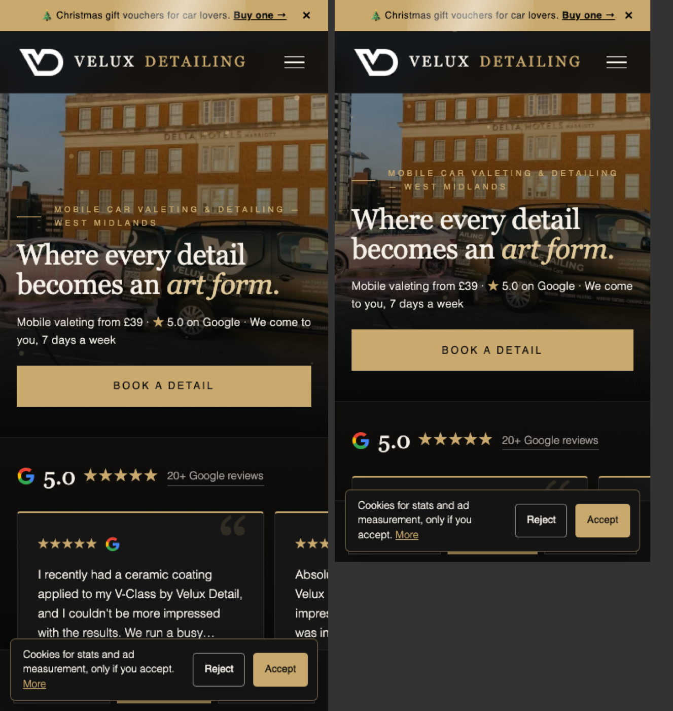
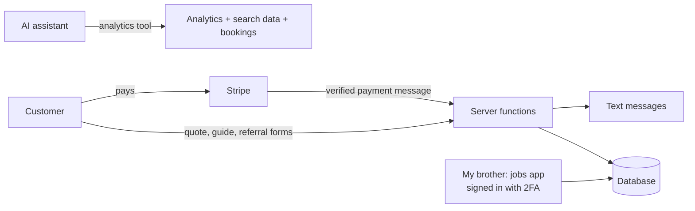
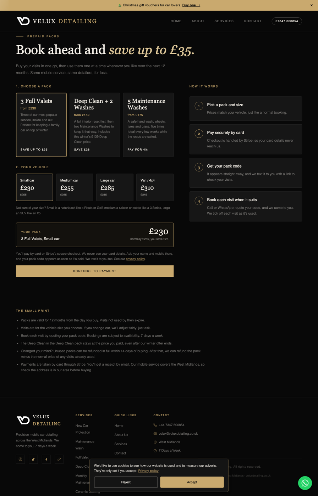
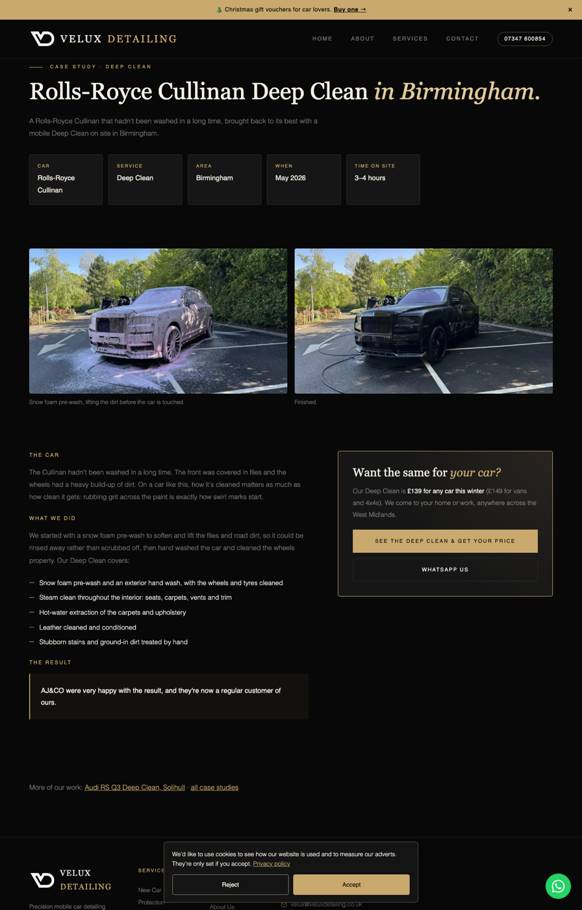

# Case study: building the digital side of a local detailing business

**Live site:** [veluxdetailing.co.uk](https://www.veluxdetailing.co.uk) · **My role:** I designed, built and run the website, online payments, automation and analytics · **The business:** Velux Detailing, my brother's mobile car valeting and detailing business in the West Midlands (he does the detailing)

My brother runs a mobile car detailing business. I took on the digital side: the website, booking and payments, automated texts, a jobs app for him to use on his phone, and the analytics we use to decide where to spend money.

This repository is a write-up of that work. The source code is private because it runs a live business, but **the best way to see it is to use the site**, and I'm happy to walk through the code in an interview.

  

---

## Try it yourself (2 minutes)

| Go to | What to look for |
|---|---|
| [Get a price](https://www.veluxdetailing.co.uk/booking) | Pick a service and car size: the price appears instantly. (Please don't submit, as it texts a real business.) |
| [Prepaid packs](https://www.veluxdetailing.co.uk/packs) | Choose a pack and vehicle size: prices, savings and the Stripe checkout link update live |
| [Gift vouchers](https://www.veluxdetailing.co.uk/gift-vouchers) | Choose "Other" and an amount: it's carried through to Stripe's payment page |
| [Refer a friend](https://www.veluxdetailing.co.uk/refer) | How the referral scheme works for customers |
| [Case studies](https://www.veluxdetailing.co.uk/our-work) | Real jobs written up for search and for trust |
| [Trade & fleet](https://www.veluxdetailing.co.uk/business) | A separate offer and enquiry form for business customers |

---

## What the business needed, and what I built

| Need | What I built |
|---|---|
| Customers wanted a price without waiting for a reply | An **instant quote form** on 12 pages: pick a service and car size, see the exact price, get a confirmation text straight away |
| A way to pay online | **Stripe payments** for gift vouchers (fixed or any amount), 8 prepaid packs and a £45/month subscription. Each payment automatically creates the voucher or pack code and texts the customer and my brother |
| Quiet months with no work booked | **Gift vouchers, prepaid packs, a subscription plan and a refer-a-friend scheme** (£10 off for the friend, £10 voucher for the customer once the friend's job is done) to earn from existing customers |
| A simple record of jobs | A **phone-first jobs app** for my brother: today's jobs, enquiries, sending a job to the detailer on WhatsApp, vouchers, packs, referrals and leads, all behind a two-factor sign-in |
| Knowing which marketing worked | **Analytics and tracking** (Google Analytics 4, Search Console, ad tracking) plus a custom tool that lets an AI assistant answer questions from the live data |
| Hard to be found on Google | Service, town and case-study pages, structured data, a free downloadable guide that captures leads, and a Google Business Profile plan |

---

## How it works

- **Website:** fast, hand-written HTML, CSS and JavaScript (no heavy framework), so pages load in about a second on a phone
- **Server functions:** TypeScript, running on Supabase. Anything involving prices, payments or personal data happens here, never in the browser
- **Database:** PostgreSQL with row-level security, so each table only opens up to the right person
- **Payments:** Stripe. Payment messages are cryptographically verified, and each one is only processed once, even if Stripe sends it twice
- **Texts:** an SMS provider's API, with daily caps so a spam attack can't run up a bill
- **Analytics tool:** a Python server that connects an AI assistant to Google Analytics, Search Console, a keyword-data API and the bookings database

More detail: [how-it-works.md](how-it-works.md)

---

## Security: I reviewed and hardened it myself

Because the site handles customer details and payments, I ran a security review and fixed what I found:

- **Two-factor sign-in enforced by the database itself.** The jobs app asked for a 2FA code, but the database would have accepted a password alone. I changed the database rules so customer data needs a 2FA-verified session, then proved it: password-only returns nothing, 2FA returns everything.
- **Payments can't be faked:** prices are set on the server and in Stripe; payment messages are signature-checked.
- **Website hardening:** security headers, escaping of anything a customer types before it's shown on screen, blocking of stray files, rate limits and spam traps on every form.
- **Privacy:** cookie consent before any analytics, marketing messages only with a ticked opt-in, and private links kept out of analytics. The privacy policy covers each feature.

---

## What the data showed

The full write-up is in [data-and-growth.md](data-and-growth.md). In short:

- **55% of visits came from Google Ads.** When ads were paused during a break in bookings, traffic dropped to a few visits a day. Ads were the engine; organic visibility was the long-term gap.
- **Visitors from unpaid Google search converted best:** 108 sessions produced 76 tracked lead actions.
- **The site wasn't the problem.** It scored 98–100 for speed and 100 for basic SEO, but ranked on pages 4–6 for local searches because few genuine sites linked to it. The fix was reviews, the Google Business Profile and local listings, not more code.
- **71% of visitors were on phones,** and the phone homepage's first screen was just a photo. I rebuilt it so the headline, price, rating and Book button show immediately.

---

## Results

- Fast: Lighthouse **98–100** performance on mobile and desktop; **96–100** accessibility after an audit
- Live and taking enquiries, with online payments for vouchers, packs and a subscription
- **53 automated tests** on the server logic (quote pricing, referral rules, reminders)
- Search, analytics and booking data in one place, so decisions are made from numbers

  
  

---

## Skills used

- **Software:** JavaScript, TypeScript, Python, SQL, HTML/CSS, APIs, webhooks, serverless functions, automated testing
- **Data:** PostgreSQL, Google Analytics 4, Search Console, funnel tracking, unit economics (customer value, acquisition cost, margin), dashboards
- **Security:** two-factor enforcement, access control, payment verification, input validation, rate limiting, UK GDPR and marketing consent
- **Payments and integrations:** Stripe (one-off, any-amount, subscriptions), SMS API, Google APIs
- **AI and automation:** AI-assisted development (Claude Code) and a custom tool that connects an AI assistant to live business data
- **Product and growth:** pricing and offers, SEO, conversion and customer-journey improvements

## How I worked

I worked out what the business needed with my brother, then designed and built it using **AI-assisted development**: Claude Code as a pair programmer, with me deciding what to build, reviewing and testing the output, and owning the result. I can explain any part of it, and I'm happy to show the private code in an interview.

---

*Ali Rahemi · [LinkedIn](https://www.linkedin.com/in/alirahemi1) · [GitHub](https://github.com/alirahemi1)*
