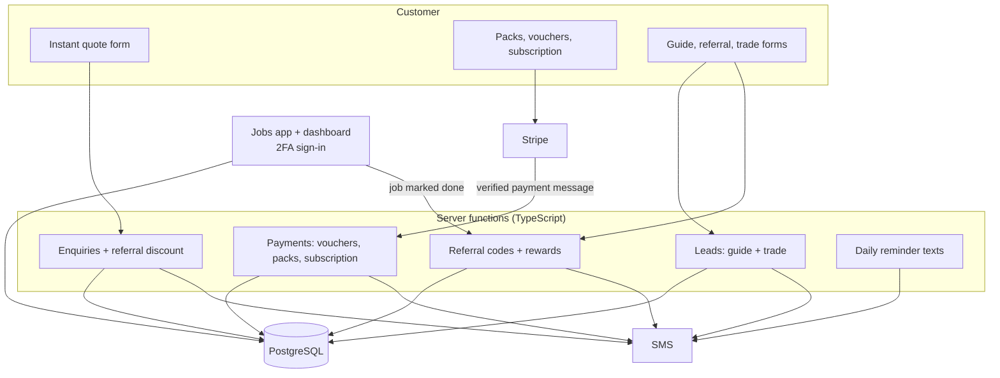

# How it works

A plain-English tour of the system behind [veluxdetailing.co.uk](https://www.veluxdetailing.co.uk). The source code is private because it runs a live business; I'm happy to walk through it in an interview.

## The big picture

The website is plain HTML, CSS and JavaScript, which keeps it fast. Anything that involves a price, a payment or personal data goes through a **server function** (TypeScript, running on Supabase), so the browser can never change a price or read someone else's details. My brother's jobs app talks to the database directly, but only after a two-factor sign-in.

## The main flows

**Getting a price.** The customer picks a service and car size and sees the price straight away. When they send it, a server function checks the details, sets the price from its own price list (not the browser's), applies a referral discount if their code is valid for them, saves the enquiry and texts them a confirmation. It ignores double-taps and caps texts per day so spam can't run up a bill.

**Paying online.** The customer pays on Stripe's own checkout page, so card details never touch our systems. Stripe then sends a payment message to a server function, which:
1. checks the message's signature, so a fake "payment" is rejected,
2. makes sure it hasn't already processed that payment (Stripe can send the same message twice),
3. creates the gift voucher, prepaid pack or subscription record with a unique code,
4. texts the customer their code and a private link, and texts my brother "sold".

**Refer a friend.** Every past customer can get a code. A friend who uses it gets £10 off their first booking, but not on their own code, not if they've booked before, and only once per person. When my brother marks the friend's job as done, the customer who referred them is texted a £10 voucher automatically. The voucher can't be sent twice, even if the button is tapped twice.

**Running the day.** The jobs app shows today's and upcoming jobs, enquiries to book, and jobs to confirm. One tap sends a job to the detailer on WhatsApp, and tapping Done sends the customer a review request. It also handles vouchers (check and redeem), packs (tick off visits), referrals and leads.

## Data model (main tables)

- **Bookings:** enquiries and jobs, moving from pending to confirmed to completed, with price, source and any referral code
- **Gift vouchers:** code, amount, balance, expiry and a private view link
- **Prepaid packs:** code, pack, vehicle size and a list of visits, each marked when used
- **Maintenance plans:** monthly plans, including subscriptions billed by Stripe
- **Referral codes and referrals:** who referred whom, linked to the friend's booking and the reward
- **Leads:** guide downloads (with a marketing opt-in flag) and trade enquiries

## Security model

- **Customers never touch the database directly.** Every public form goes through a server function that validates the input, checks it came from our site, rate-limits and uses spam traps.
- **Two-factor sign-in is enforced by the database:** every table with customer data refuses requests that haven't passed the 2FA step. I tested this both ways.
- **Payments are trusted only from Stripe,** via signed messages, processed once.
- **The web server** sends security headers, keeps the admin pages out of search engines and blocks stray files.
- **Privacy:** analytics only after cookie consent, and private links are removed before page addresses go to analytics.

## Testing

The enquiry, referral and reminder logic is covered by **53 automated tests** that use a fake network, so nothing is saved and no texts are sent. Database security rules were tested by simulating password-only and 2FA sessions and checking what each could see.
